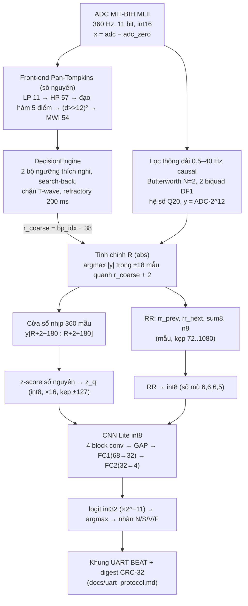

# Tổng quan hệ thống: từ mẫu ADC đến nhãn N/S/V/F

Tài liệu học tập. Mọi con số dưới đây lấy từ code, config và mô hình đóng băng (`export/final_models_manifest.json`),
không ước lượng. Phần CNN được giải thích chi tiết trong [`cnn_explained.md`](cnn_explained.md); giao thức UART trong
[`uart_protocol.md`](uart_protocol.md); kết quả DS2 trong [`final_ds2_results.md`](final_ds2_results.md).

## 1. Luồng tổng

Có hai nhánh song song từ cùng mẫu ADC:
- **nhánh phát hiện** (Pan-Tompkins) chỉ để tìm *vị trí* nhịp;
- **nhánh hình dạng** (lọc 0.5–40 Hz) cung cấp tín hiệu cho tinh chỉnh R, cửa sổ nhịp và CNN.

Nhịp k chỉ được phân loại khi đã biết **R kế tiếp** (cần `rr_next`) và cửa sổ đủ 180 mẫu sau R. Vì vậy độ trễ từ R
đến lúc có nhãn là khoảng 1 RR cộng thời gian xác nhận đỉnh; đo trên 8 đoạn golden, tối đa là 1.1–2.4 s.

## 2. Hai phiên bản của cùng một pipeline

| | float (huấn luyện, đánh giá CV) | số nguyên (triển khai, golden cho C) |
|---|---|---|
| phát hiện R thô | `python/dsp/pan_tompkins.py` (số nguyên, **dùng chung**) | như bên trái |
| lọc 0.5–40 Hz | `python/dsp/filters.py::apply_offline` (`sosfilt`, float64) | `python/quant/pipeline_int.py::filter_int` (Q20, 12 bit bảo vệ) |
| tinh chỉnh R | `python/dsp/realign.py::realign_one` (mode `abs`) | `pipeline_int.py::refine_abs_int` |
| cửa sổ + z-score | `python/data/beats.py::extract_windows`, `normalize_beats` | `pipeline_int.py::run_integer_beats`, `zscore_int` |
| RR | `beats.py::rr_features` (giây) | `run_integer_beats` (mẫu) + `scripts/pipeline_int_eval.py::quantise_rr_parts` |
| CNN | `python/models/cnn1d.py::ECGCNN` (PyTorch) | `python/quant/int8.py::int_forward_q` |
| từng mẫu (stream) | — | `python/viz/stream.py::IntegerPipelineStream` |

Bản số nguyên là cùng các bước, chỉ đổi số học sang số nguyên. CLAUDE.md quy tắc 4 ("cùng một pipeline") được kiểm
bằng cổng (iii): macro-F1 OOF của bản số nguyên hoàn toàn so với bản float trên DS1 là 0.5096 so với 0.5089, tức
giảm −0.0007 (bản số nguyên còn nhỉnh hơn), ngưỡng cho phép là ≤ 0.02. Bản stream trùng **từng bit** với bản offline
trên 8 đoạn golden (1306 nhịp, `tests/test_stream.py`, `live_monitor --check all`).

## 3. Từng tầng

Quy ước scale: "×2^−e" nghĩa là giá trị thực = số nguyên × 2^−e.

### 3.1 Dữ liệu ADC

| | |
|---|---|
| file / hàm | `python/data/mitbih.py::load_record` → `Record` |
| vào | file WFDB `data/raw/<id>.{hea,dat,atr}` (MIT-BIH Arrhythmia) |
| ra | `adc`: int16, shape (650 000,) cho 30 phút; `adc_zero` = 1024; `adc_gain` = 200 ADC/mV; `fs` = 360 Hz; kênh MLII |
| quan hệ | `signal_mV = (adc − adc_zero) / adc_gain` |
| tham số chốt | loại 102, 104, 107, 217 (paced); DS1/DS2 theo de Chazal; DS2 bị khoá bằng `ECG_ALLOW_DS2` |

Nhãn: annotation MIT-BIH → AAMI (N = N,L,R,e,j; S = A,a,J,S; V = V,E; F = F; Q bị loại). Nhịp nằm trong đoạn
VF (rung thất) không được tính.

### 3.2 Front-end Pan-Tompkins (số nguyên)

| | |
|---|---|
| file / hàm | `python/dsp/pan_tompkins.py::FrontEnd.push` (từng mẫu), `frontend_offline` (cả bản ghi, trùng bit) |
| vào | `x = adc − adc_zero` (int, \|x\| ≤ 2^10) |
| ra | mỗi mẫu: `hp` (band-pass), `d` (đạo hàm), `mwi` (int32) |
| tham số chốt (360 Hz) | LP = 2 tổng trượt dài 11 (trễ 10); HP = `57·lp[n−28] − sum57(lp)` (trễ 28); đạo hàm `2x[n]+x[n−1]−x[n−3]−2x[n−4]` (trễ 2); bình phương `(d >> 12)²`; MWI = tổng trượt dài 54 (150 ms) |
| ngân sách int32 | MWI tối đa 2^29.3 < 2^31 (docstring `pan_tompkins.py`) |

Tổng trễ của band-pass là 38 mẫu. Vì vậy vị trí R thô là `r_coarse = bp_idx − 38`, tính theo thời gian của tín hiệu gốc.

### 3.3 Quyết định QRS (`DecisionEngine`)

| | |
|---|---|
| file / hàm | `pan_tompkins.py::DecisionEngine.process`, `flush` |
| vào | (`hp`, `d`, `mwi`) từng mẫu |
| ra | `Detection(bp_idx, mwi_idx, r_coarse, searchback, emitted_at)` |
| tham số chốt | 2 bộ ngưỡng (I trên MWI, F trên \|hp\|): `SPK += (peak − SPK) >> 3`, `THR1 = NPK + ((SPK − NPK) >> 2)`, `THR2 = THR1 >> 1`; học 2 s (720 mẫu) sau 133 mẫu ổn định; xác nhận đỉnh 36 mẫu; refractory 72 mẫu (200 ms); T-wave 130 mẫu (dốc < ½ dốc nhịp trước); search-back khi quá `1.65625 × RR_avg2`; `irregular_halving = true` |
| kết quả DS1 | Se 99.633 %, +P 99.146 % (±150 ms); DS2 (người dùng chạy 1 lần): Se 99.753 %, +P 99.682 % |

### 3.4 Lọc thông dải 0.5–40 Hz

| | |
|---|---|
| file / hàm | số nguyên: `python/quant/pipeline_int.py::filter_int` → `filter_int.py::sos_filter_int`; float: `filters.py::apply_offline`; stream: `viz/stream.py::IntegerFilterStream` |
| vào | `x = adc − adc_zero` |
| ra | `y_int`: int (vừa int32), scale ADC × 2^12 (12 bit bảo vệ); mV = `y_int / 2^12 / 200` |
| thiết kế | Butterworth, `order: 2` → 4 cực, 2 biquad, **causal** (không dùng filtfilt) |
| hệ số Q20 | biquad 1: b = (82588, 165177, 82588), a1 = −1118928, a2 = 402899; biquad 2: b = (1048576, −2097152, 1048576), a1 = −2084217, a2 = 1035722 (chia cho 2^20) |
| số học | DF1, accumulator int64, `y = (acc + 2^19) >> 20` |
| trễ dùng để ánh xạ | group delay tại 10 Hz, làm tròn = **2 mẫu** (`group_delay_compensation`) |

### 3.5 Tinh chỉnh R

| | |
|---|---|
| file / hàm | `pipeline_int.py::refine_abs_int` (float: `realign.py::realign_one`, mode `abs`) |
| vào | `r_coarse`, `y_int`, delay 2, nửa cửa sổ 18 mẫu (±0.05 s) |
| ra | `r`: argmax \|y\| trong `[r_coarse + 2 − 18, r_coarse + 2 + 18]`, trừ đi 2; nếu argmax nằm ở **biên** cửa sổ thì giữ `r_coarse` (cờ `edge`) |

Annotation cũng được re-align theo cùng cách khi dùng phân đoạn theo annotation.

### 3.6 Cửa sổ nhịp và z-score

| | |
|---|---|
| file / hàm | `pipeline_int.py::run_integer_beats`, `zscore_int` (float: `beats.py::extract_windows`, `normalize_beats`) |
| vào | `y_int`, R đã tinh chỉnh |
| cửa sổ | `w = y_int[R + 2 − 180 : R + 2 + 180]`, shape (360,), int32; R nằm ở chỉ số 180 |
| z-score số nguyên | `m = round_div(Σw, 360)`, `d = w − m`, `sd = isqrt(round_div(Σd², 360))`, `z_q = clamp(round_div(d·16, sd + 1), −127, 127)` |
| ra | `z_q`: (360,), dải int8, scale ×2^−4 (127/16 ≈ 7.94, tức kẹp ở ±8 độ lệch chuẩn) |
| float tương ứng | `(w − μ)/(σ + 1e−6)`, kẹp ±8; ε = 1e−6 mV ≈ 0.8 đơn vị số nguyên nên dùng `+1` |
| điều kiện | chỉ nhịp 1..n−2 (cần R trước và R sau) có cửa sổ đủ trong bản ghi |

### 3.7 Đặc trưng RR

| | |
|---|---|
| file / hàm | `run_integer_beats` (phần `rr_parts`), `quantise_rr_parts`; float: `beats.py::rr_features` |
| vào | dãy R đã tinh chỉnh; mọi khoảng RR được kẹp vào [72, 1080] mẫu = [0.2, 3.0] s |
| ra (nguyên) | `rr_parts = (rr_prev, rr_next, sum8, n8)` (mẫu), với `sum8` là tổng ≤ 8 RR quá khứ **kể cả** `rr_prev` |
| 4 đặc trưng | rr_prev, rr_next, rr_avg = sum8 / n8, ratio = rr_prev / rr_avg |
| lượng tử | `rr_q = clamp(round(feature × 2^e), ±127)`, e = (6, 6, 6, 5): rr_prev = `round_div(rp·2^6, 360)`, …, ratio = `round_div(rp·n8·2^5, sum8)` (phân số chính xác) |
| chú ý | với e = 6, RR > 127/64 ≈ 1.98 s bão hoà ở 127 (số mũ hiệu chỉnh theo max của tập hiệu chỉnh) |

Chỉ dùng RR trước, RR sau ngay kề và trung bình RR quá khứ, đúng CLAUDE.md quy tắc 3.

### 3.8 CNN Lite int8

| | |
|---|---|
| file / hàm | `python/quant/int8.py::int_forward_q` (golden cho C), `int_forward_trace` (mọi tầng trung gian) |
| vào | `z_q` (360,) int8, `rr_q` (4,) int8 |
| ra | `logits` (4,) int32, scale chung ×2^−11 |
| mô hình | `results/2026-10-15_581b4c74_final_A5_svdb_n25_lite_e3/lite_int8.npz` (SHA-256 kiểm tra mỗi lần nạp) |
| kích thước | 23 408 B trọng số int8 + 212 bias int32 (848 B); 1 609 344 MAC/nhịp |

Chi tiết từng lớp: [`cnn_explained.md`](cnn_explained.md).

### 3.9 Nhãn

`pred = argmax(logits)`: 0 N, 1 S, 2 V, 3 F. Không cần softmax trên board (xem `cnn_explained.md` §5). Host
(`live_monitor`) tự tính softmax từ logit chỉ để hiển thị xác suất.

## 4. Huấn luyện và đánh giá (tóm tắt)

- Nhịp huấn luyện: 50 785 nhịp DS1 (nguồn R = detector, ghép một-một với annotation ±150 ms để gán nhãn).
  Mô hình Lite cuối có thêm SVDB (n25) **chỉ trong inner-train**.
- CV: 5 fold nhóm theo bản ghi trên DS1; inner-val = 20 % cuối theo thời gian của mỗi bản ghi train (đệm 1 s);
  chỉ số chính là macro-F1 trên OOF gộp, 3 seed.
- Lite cuối: focal loss (γ = 2) + trọng số sqrt-inverse, AdamW lr 1e−3, wd 1e−2, 3 epoch, không augmentation;
  OOF macro-F1 (CV) 0.5089 ± 0.0078; train lại trên toàn DS1 với seed 42.
- Lượng tử hoá: hiệu chỉnh "max" trên tập train; cổng lượng tử −0.0007 và cổng pipeline số nguyên (iii) −0.0007, đều ĐẠT.
- DS2 (người dùng chạy một lần, 15/10/2026): Lite số nguyên macro-F1 0.6029 (annotation) / 0.5940 (e2e gross),
  xem `final_ds2_results.md`. Từ đó mô hình đóng băng.

## 5. Kiểm chứng và công cụ quan sát

| mục đích | lệnh |
|---|---|
| golden vectors cho C | `scripts/export_c.py` → `export/weights.h`, `export/golden/*.bin` |
| bản stream = golden, qua UART | `python scripts/live_monitor.py --check all` (Cổng 4: digest board = golden) |
| xem một bản ghi | `python scripts/view_record.py --record 208` (DS1 mặc định dùng mô hình OOF) |
| gallery nhầm lẫn | `python scripts/beat_gallery.py --split ds1` |
| theo dõi 1 nhịp qua mọi tầng | `python scripts/trace_beat.py --golden rec208_237600 --beat 12` (hoặc `--first-of V`) |
