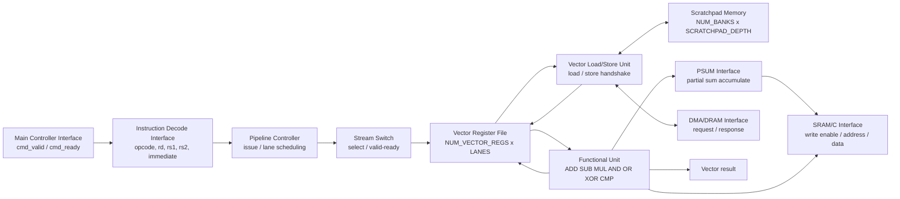
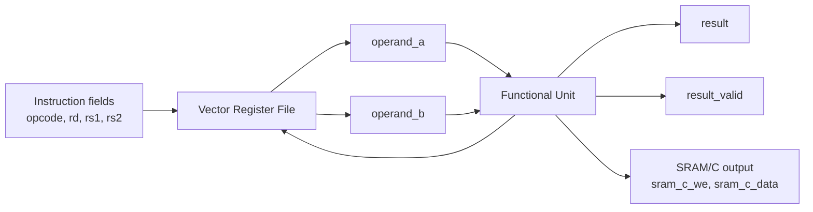
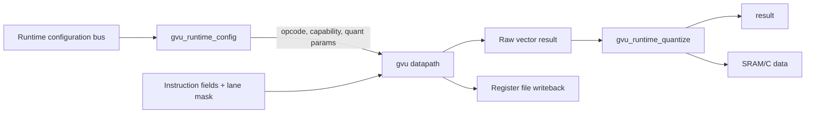
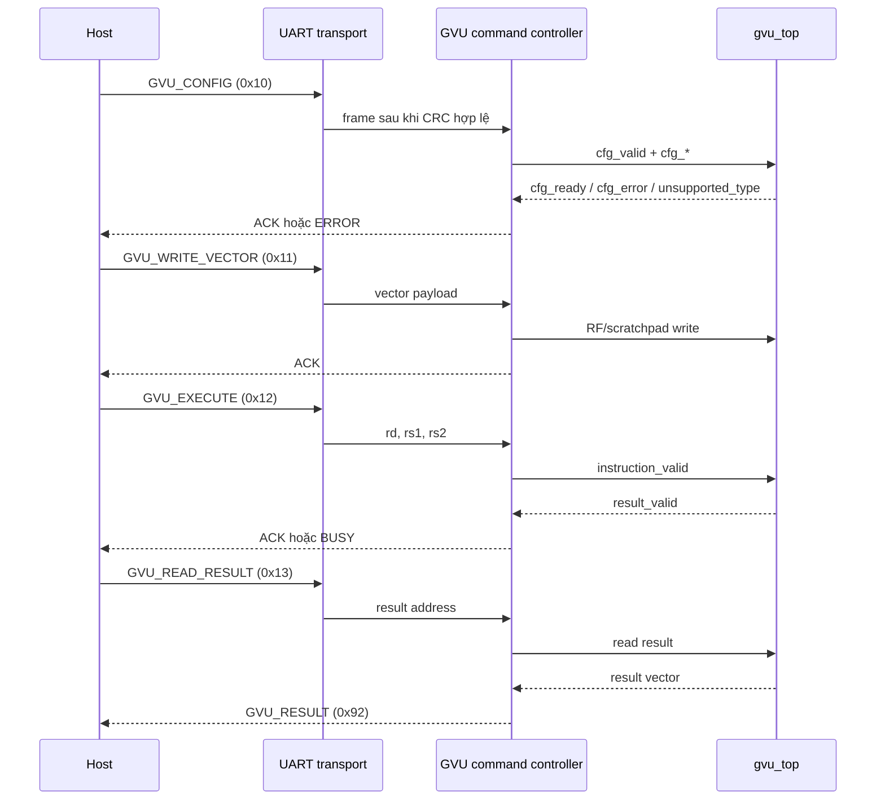

# Generic Vector Unit (GVU)

Tài liệu này mô tả kiến trúc GVU trong `gvu_architecture.sv`. Thiết kế được chia thành các module độc lập, có tham số SystemVerilog để thay đổi cấu hình tại thời điểm elaboration.

## 1. Mục tiêu thiết kế

GVU cung cấp một datapath vector tổng quát cho các phép toán thường dùng trong xử lý tín hiệu và tăng tốc AI/CNN:

- số học: cộng, trừ, nhân;
- logic: AND, OR, XOR;
- so sánh signed;
- đọc/ghi vector register file;
- scratchpad và giao tiếp load/store;
- giao tiếp DMA/DRAM, SRAM/C và PSUM;
- mở rộng số lane, độ rộng dữ liệu, số thanh ghi, độ sâu bộ nhớ và số FU bằng parameter.

## 1.1. Package cấu hình chung

File: `gvu_config_pkg.sv`

Package `gvu_config_pkg` là nguồn mặc định dùng chung cho các module GVU. Các tham số chính gồm:

| Nhóm | Tham số |
|---|---|
| Datapath | `DATA_WIDTH`, `MAX_VECTOR_WIDTH`, `VECTOR_LANES`, `ACC_WIDTH`, `PSUM_WIDTH` |
| Register/memory | `NUM_VECTOR_REGS`, `NUM_SCRATCHPAD_BANKS`, `SCRATCHPAD_DEPTH`, `REG_ADDR_WIDTH`, `MEM_ADDR_WIDTH` |
| Điều khiển | `OPCODE_WIDTH`, `MAX_OUTSTANDING`, `PIPELINE_STAGES`, `MAX_INFLIGHT_OPS` |
| Kiểu dữ liệu | `SUPPORT_INT8`, `SUPPORT_INT16`, `SUPPORT_INT32`, `SUPPORT_FP16`, `SUPPORT_FP32` |
| Số học | `SUPPORT_SATURATION`, `SUPPORT_ROUNDING` |

Module có thể override tham số riêng khi elaboration, nhưng các default đều lấy từ package. Nhờ đó một cấu hình mới không cần sửa các hằng số độ rộng rải rác trong RTL.

Package cũng định nghĩa opcode dùng chung: `OP_ADD`, `OP_SUB`, `OP_MUL`, `OP_AND`, `OP_OR`, `OP_XOR`, `OP_SLT`.

### Kiểm tra cấu hình

`gvu_config_check` kiểm tra tại thời điểm khởi tạo mô phỏng/elaboration các điều kiện tối thiểu:

- `DATA_WIDTH > 0`;
- `MAX_VECTOR_WIDTH >= DATA_WIDTH * VECTOR_LANES`;
- số register, số bank và độ sâu scratchpad lớn hơn zero;
- `ACC_WIDTH >= DATA_WIDTH`;
- `MAX_OUTSTANDING`, `MAX_INFLIGHT_OPS` và `PIPELINE_STAGES` lớn hơn zero;
- phải bật ít nhất một kiểu dữ liệu số nguyên hoặc số thực.

Cấu hình không hợp lệ tạo `$fatal` với thông báo `Invalid GVU configuration`.

Module `functional_unit` cũ trong file `fu` được giữ nguyên để bảo đảm tương thích với testbench hiện hữu. Kiến trúc mới nằm trong file `gvu_architecture.sv` và không thay đổi các module CNN cũ bên ngoài thư mục GVU.

## 2. Sơ đồ kiến trúc



Sơ đồ trên mô tả các đường chức năng của GVU. Trong phiên bản RTL hiện tại, `gvu` top-level đã kết nối trực tiếp:



Các module `gvu_pipeline_controller`, `gvu_stream_switch`, `gvu_scratchpad_memory`, `gvu_vlsu`, `gvu_dma_if` và `gvu_psum_if` đã có interface độc lập để tích hợp ở bước tiếp theo; chúng chưa được nối toàn bộ vào datapath của `gvu` top-level hiện tại.

## 3. Các khối RTL

### 3.1 Pipeline Controller

Module: `gvu_pipeline_controller`

Chức năng:

- nhận `start` và `opcode`;
- phát `issue_valid` cho từng lane;
- tạo `lane_index`;
- báo trạng thái `busy`;
- dừng khi phát đủ `VECTOR_LEN` phần tử hoặc nhận `done`.
- dừng cấp phát khi `dependency_stall` hoặc `resource_stall` được bật;
- hỗ trợ `flush` để hủy lệnh đang chạy;
- xuất `stall`, `complete` và `error` cho tầng điều phối.

Tham số chính:

| Tham số | Ý nghĩa |
|---|---|
| `OPCODE_WIDTH` | Độ rộng opcode |
| `VECTOR_LEN` | Số phần tử cần issue |

### 3.2 Instruction Decode Interface

Module: `gvu_instruction_decode_if`

Định dạng instruction được suy ra từ các tham số:

```text
| immediate | rs2 | rs1 | rd | opcode |
```

Độ rộng tổng:

```text
INSTRUCTION_WIDTH = OPCODE_WIDTH
				   + 3 * REGISTER_INDEX_WIDTH
				   + IMMEDIATE_WIDTH
```

Khối này chỉ giải mã trường lệnh, không chứa logic điều phối hay thực thi. `valid_in` được truyền thành `valid_out`; opcode ngoài map được báo qua `illegal_instruction`. Định dạng trường lệnh là một interface có tham số, không phải cam kết ISA cố định.

### 3.3 Main Controller Interface

Module: `gvu_main_controller_if`

Đây là giao diện nhận lệnh điều khiển từ bộ điều khiển chính của hệ thống. Lệnh được truyền qua handshake `cmd_valid/cmd_ready` và lưu trong `control_state`.

### 3.4 Stream Switch

Module: `gvu_stream_switch`

Khối chọn một lane từ bus vector đầu vào dựa trên `select`. Giao diện sử dụng handshake:

- `in_valid[]`, `in_ready[]`: trạng thái từng lane;
- `out_valid`, `out_ready`: luồng đầu ra;
- `select`: lane được chọn.

### 3.5 Vector Register File

Module: `gvu_vector_register_file`

Register file gồm `REGISTER_COUNT` thanh ghi, mỗi thanh ghi chứa `LANES` phần tử và mỗi phần tử có `DATA_WIDTH` bit.

```text
storage = REGISTER_COUNT x LANES x DATA_WIDTH
```

Đặc điểm:

- hai cổng đọc vector `read_data_a` và `read_data_b`;
- một cổng ghi vector;
- `write_lane_mask` cho phép chỉ cập nhật các lane được chọn;
- số thanh ghi và số lane không cố định;
- reset xóa toàn bộ register file;
- hiện hỗ trợ hai cổng đọc logic và một cổng ghi; arbitration nhiều cổng vật lý là phần mở rộng tiếp theo.

### 3.6 Scratchpad Memory

Module: `gvu_scratchpad_memory`

Scratchpad là bộ nhớ đồng bộ gồm `NUM_BANKS` bank, mỗi bank có `DEPTH` phần tử:

- ghi khi `write_en = 1`;
- đọc khi `read_en = 1`;
- kết quả đọc hợp lệ ở chu kỳ kế tiếp qua `read_valid`.

Địa chỉ logic được ánh xạ thành `bank = address / DEPTH` và `element = address % DEPTH`. Độ rộng địa chỉ được suy ra từ `NUM_BANKS * DEPTH` nếu không truyền tham số riêng.

Phiên bản hiện tại dùng một cổng đọc/ghi logic. Chính sách xung đột bank và nhiều giao dịch cùng chu kỳ cần được bổ sung khi mở rộng thành nhiều cổng vật lý.

### 3.7 Vector Load/Store Unit

Module: `gvu_vlsu`

VLSU chuyển đổi yêu cầu load/store vector thành giao diện bộ nhớ:

- load: `load_valid`, `load_address`, `load_data`;
- store: `store_valid`, `store_address`, `store_data`;
- bộ nhớ: `mem_write_*` và `mem_read_*`.

Các tín hiệu `load_ready` và `store_ready` hiện luôn ở mức một, phù hợp với phiên bản giao diện cơ sở không có hàng đợi outstanding request. `MAX_OUTSTANDING` đã được đưa vào cấu hình để dành chỗ cho FIFO/credit tracking khi VLSU được mở rộng.

### 3.8 Functional Unit

Module: `gvu_functional_unit`

FU thực thi cùng một opcode trên tất cả lane của vector. Kết quả được chốt theo clock và trả qua `valid_out`.

| Opcode | Phép toán |
|---|---|
| `8'h00` | signed add |
| `8'h01` | signed subtract |
| `8'h02` | signed multiply |
| `8'h03` | bitwise AND |
| `8'h04` | bitwise OR |
| `8'h05` | bitwise XOR |
| `8'h06` | signed less-than |
| khác | truyền `operand_a` |

Các tham số quan trọng:

| Tham số | Ý nghĩa |
|---|---|
| `LANES` | Số lane song song |
| `DATA_WIDTH` | Độ rộng toán hạng |
| `ACC_WIDTH` | Độ rộng kết quả |
| `OPCODE_WIDTH` | Độ rộng opcode |
| `FU_COUNT` | Số FU dành cho cấu hình mở rộng |
| `PIPELINE_STAGES` | Số tầng pipeline được phép cấu hình |
| `MAX_INFLIGHT_OPS` | Số phép toán đang chờ tối đa |
| `SUPPORT_SATURATION` | Bật/tắt hỗ trợ bão hòa |
| `SUPPORT_ROUNDING` | Bật/tắt hỗ trợ làm tròn |

`FU_COUNT` đã được đưa vào cấu hình của module; bản FU hiện tại dùng một datapath logic dùng chung cho toàn vector. Việc nhân bản nhiều FU vật lý cần được nối thêm ở tầng scheduler khi kiến trúc được mở rộng. Các cờ saturation/rounding hiện là capability parameters để giữ hợp đồng kiến trúc; opcode số học hiện tại chưa thêm opcode riêng cho hai chế độ này.

### 3.9 PSUM Interface

Module: `gvu_psum_if`

Khối này hỗ trợ cộng partial sum theo từng lane:

```text
partial_sum_out = partial_sum_in + accumulation
```

Khi `accumulate_en = 0`, dữ liệu đầu vào được chuyển thẳng ra đầu ra.

### 3.10 DMA/DRAM Interface

Module: `gvu_dma_if`

Giao diện này nối request nội bộ với bus DMA bên ngoài:

- request đọc/ghi có địa chỉ và dữ liệu ghi;
- `dma_ready` điều khiển backpressure;
- dữ liệu đọc được trả qua `response_valid`, `response_rdata`;
- request đọc tạo response ở chu kỳ sau.

### 3.11 SRAM/C Interface

Module: `gvu_sram_c_if`

Đây là giao diện ghi kết quả ra SRAM C:

- `sram_we`: cho phép ghi;
- `sram_address`: địa chỉ đích;
- `sram_wdata`: dữ liệu vector hoặc dữ liệu đã đóng gói.

Trong top-level `gvu`, kết quả FU được đưa trực tiếp ra `sram_c_data` và `sram_c_we` bám theo `result_valid`.

## 4. Luồng hoạt động

### 4.1 Luồng thực thi vector

1. Instruction hoặc trường điều khiển cung cấp `opcode`, `rd`, `rs1`, `rs2` và lane mask.
2. Vector Register File đọc hai vector toán hạng.
3. Functional Unit thực hiện opcode trên từng lane.
4. Kết quả được chốt tại cạnh lên clock.
5. `result_valid` báo kết quả hợp lệ.
6. Kết quả có thể ghi ngược về register `rd` và đồng thời xuất ra giao diện SRAM/C.

### 4.2 Handshake FU

```text
accept_input = valid_in && ready_in
produce_output = valid_out
ready_in = ready_out || !valid_out
```

Với `ready_out = 1`, FU có thể nhận vector mới ở các chu kỳ liên tiếp.

## 5. Tính parameterized/configurable

Cấu hình ví dụ:

```systemverilog
gvu #(
	.DATA_WIDTH(8),
	.MAX_VECTOR_WIDTH(256),
	.LANES(8),
	.REGISTER_COUNT(64),
	.NUM_SCRATCHPAD_BANKS(4),
	.SCRATCHPAD_DEPTH(4096),
	.ACC_WIDTH(32),
	.PSUM_WIDTH(32),
	.FU_COUNT(2),
	.MAX_OUTSTANDING(8),
	.PIPELINE_STAGES(2),
	.MAX_INFLIGHT_OPS(16),
	.OPCODE_WIDTH(8),
	.ADDRESS_WIDTH(20),
	.SUPPORT_INT8(1'b1),
	.SUPPORT_INT16(1'b1),
	.SUPPORT_INT32(1'b1),
	.SUPPORT_SATURATION(1'b1),
	.SUPPORT_ROUNDING(1'b1)
) dut (...);
```

Các đại lượng được suy ra bằng `$clog2` khi phù hợp, tránh phải sửa độ rộng thủ công khi thay đổi số thanh ghi, số lane hoặc độ sâu bộ nhớ. Tham số phần cứng như `LANES`, `DATA_WIDTH`, `NUM_VECTOR_REGS` được chốt khi elaboration; các trường `opcode`, lane mask, valid/ready và stall/flush là điều khiển runtime.

## 6. Kiểm thử

Testbench: [tb_gvu_architecture.sv](../tb/tb_gvu_architecture.sv)

Testbench kiểm tra:

- giải mã instruction;
- phép cộng vector hai lane;
- phép nhân vector hai lane;
- cấu hình `FU_COUNT` khác giá trị mặc định.
- decode hợp lệ và phát hiện opcode không hợp lệ;
- lane mask trong register file;
- package configuration được biên dịch cùng RTL.

Lệnh chạy kiểm thử:

```bash
iverilog -g2012 -s tb_gvu_architecture \
  -o /tmp/tb_gvu \
  rtl/cnn1d/GVU/gvu_architecture.sv \
  rtl/cnn1d/tb/tb_gvu_architecture.sv
vvp /tmp/tb_gvu
```

Testbench `functional_unit` cũ cũng tiếp tục chạy thành công, xác nhận module FU cũ không bị thay đổi.

## 7. Phạm vi tích hợp hiện tại

Phiên bản hiện tại là nền tảng kiến trúc GVU có các interface rõ ràng và có thể kiểm thử riêng. Top-level `gvu` hiện tập trung vào đường thực thi:

```text
Instruction fields -> Vector Register File -> Functional Unit -> Result/SRAM-C
									  ^              |
									  +--------------+
```

Các bước mở rộng tiếp theo khi tích hợp vào hệ thống hoàn chỉnh:

1. nối Instruction Decode với Pipeline Controller;
2. nối VLSU với Scratchpad và DMA;
3. đưa PSUM vào datapath MAC/CNN;
4. thêm scheduler cho nhiều `FU_COUNT`;
5. thêm opcode register hoặc thanh ghi cấu hình runtime;
6. bổ sung backpressure và hàng đợi cho các request bộ nhớ ngoài.

## 8. Cấu hình phần cứng và cấu hình lúc chạy

### 8.1. Cấu hình lúc biên dịch/elaboration

Các đặc tính sau tạo ra tài nguyên phần cứng và phải được chốt khi tổng hợp:

- `LANES` / `VECTOR_LANES`: số lane xử lý song song;
- `DATA_WIDTH`, `ACC_WIDTH`, `PSUM_WIDTH`: độ rộng datapath, accumulator và partial sum;
- `REGISTER_COUNT`: số vector register;
- `NUM_SCRATCHPAD_BANKS`, `SCRATCHPAD_DEPTH`: số bank và số phần tử mỗi bank;
- số cổng thực tế của từng khối memory/FU;
- `FU_COUNT`: số Functional Unit được tổng hợp;
- `PIPELINE_STAGES`: độ sâu pipeline mà RTL hỗ trợ;
- `MAX_OUTSTANDING`, `MAX_INFLIGHT_OPS`: năng lực theo dõi giao dịch và phép toán đang chờ;
- các capability `SUPPORT_INT8/16/32`, `SUPPORT_FP16/32`, `SUPPORT_SATURATION`, `SUPPORT_ROUNDING`.

Thay đổi các tham số này có thể thay đổi số LUT/FF/DSP/BRAM và timing. `gvu_config_check` chặn các tổ hợp hiển nhiên không hợp lệ trước khi mô phỏng.

### 8.2. Cấu hình lúc chạy

`gvu_runtime_config` trong [gvu_top.sv](gvu_top.sv) lưu các trường điều khiển runtime:

- opcode và chế độ thực thi;
- data type trong tập capability đã tổng hợp;
- lane mask;
- vector length trong khoảng `1..LANES`;
- stride và offset địa chỉ;
- shift và rounding mode;
- clamp min/max và chế độ accumulate;
- địa chỉ/kích thước transaction được truyền qua các interface memory.

Một trường runtime không được phép tạo ra tài nguyên mới. Ví dụ, `cfg_data_type = DATA_TYPE_FP32` bị báo `unsupported_type` nếu `SUPPORT_FP32=0`; cấu hình không được commit và `instruction_valid` bị chặn qua `cfg_error`. Tương tự, vector length bằng zero, vượt `LANES`, rounding khi capability tắt hoặc clamp min lớn hơn max đều bị từ chối.

Khối `gvu_runtime_quantize` đã áp dụng shift, rounding và saturation lên kết quả top-level. Stride/offset, transaction size và accumulate hiện được lưu trong runtime register để giao cho VLSU/PSUM ở bước tích hợp bộ nhớ tiếp theo; chúng chưa tự động thay đổi địa chỉ hoặc cộng PSUM trong datapath `gvu` hiện tại.

## 9. Top-level và interface tích hợp

Top-level: [gvu_top.sv](gvu_top.sv)



`gvu_top` giữ tách biệt hai loại cấu hình: parameter phần cứng nằm trong danh sách `parameter`, còn bus `cfg_*` chỉ điều khiển tài nguyên đã tồn tại.

## 10. Opcode map và định dạng lệnh mở rộng

Opcode cơ sở trong package:

| Opcode | Ý nghĩa |
|---|---|
| `OP_ADD` | signed add |
| `OP_SUB` | signed subtract |
| `OP_MUL` | signed multiply |
| `OP_AND` | bitwise AND |
| `OP_OR` | bitwise OR |
| `OP_XOR` | bitwise XOR |
| `OP_SLT` | signed less-than |

Định dạng mẫu của `gvu_instruction_decode_if` vẫn có thể mở rộng theo tham số:

```text
| immediate | rs2 | rs1 | rd | opcode |
```

Khi thêm FU mới, thêm opcode trong package, thêm nhánh decode/dispatch của FU và testbench cho opcode đó. Không cần thay đổi RF, scratchpad, VLSU hoặc giao diện SRAM/C nếu FU giữ contract `valid/ready`, operand vector và result vector hiện có.

## 11. Kiểm thử tính linh hoạt

Các testbench:

- [tb_gvu_architecture.sv](../tb/tb_gvu_architecture.sv): decode và phép toán vector cơ bản;
- [tb_gvu_configurations.sv](../tb/tb_gvu_configurations.sv): ba cấu hình elaboration;
- [tb_gvu_runtime_config.sv](../tb/tb_gvu_runtime_config.sv): capability runtime và kiểm tra cấu hình không hợp lệ.

Ba cấu hình đã kiểm tra:

| Cấu hình | LANES | DATA_WIDTH | ACC_WIDTH | FU_COUNT |
|---|---:|---:|---:|---:|
| Nhỏ | 2 | 8 | 16 | 1 |
| Trung bình | 4 | 16 | 32 | 2 |
| Mở rộng | 8 | 16 | 64 | 4 |

Các ca đã kiểm tra gồm signed add/subtract, multiply, thay đổi số lane/độ rộng mà không sửa RTL nội bộ, runtime FP32 không hỗ trợ, vector length zero, reset và valid pipeline. Backpressure được biểu diễn bởi `ready_in/ready_out`; khi `ready_out=0`, FU giữ `valid_out` và kết quả cho tới khi downstream nhận.

Lệnh chạy regression:

```bash
iverilog -g2012 -s tb_gvu_architecture -o /tmp/tb_gvu \
	rtl/cnn1d/GVU/gvu_config_pkg.sv \
	rtl/cnn1d/GVU/gvu_architecture.sv \
	rtl/cnn1d/tb/tb_gvu_architecture.sv && vvp /tmp/tb_gvu

iverilog -g2012 -s tb_gvu_configurations -o /tmp/tb_gvu_cfg \
	rtl/cnn1d/GVU/gvu_config_pkg.sv \
	rtl/cnn1d/GVU/gvu_architecture.sv \
	rtl/cnn1d/tb/tb_gvu_configurations.sv && vvp /tmp/tb_gvu_cfg

iverilog -g2012 -s tb_gvu_runtime_config -o /tmp/tb_gvu_runtime \
	rtl/cnn1d/GVU/gvu_config_pkg.sv \
	rtl/cnn1d/GVU/gvu_architecture.sv \
	rtl/cnn1d/GVU/gvu_top.sv \
	rtl/cnn1d/tb/tb_gvu_runtime_config.sv && vvp /tmp/tb_gvu_runtime
```

## 12. Đánh giá tài nguyên và hiệu năng

Với datapath hiện tại, một FU xử lý toàn bộ `LANES` trong một vector transaction. Khi `ready_out=1`, throughput lý thuyết là một vector mỗi chu kỳ sau latency đăng ký một chu kỳ. Latency thực tế của pipeline tổng thể bằng số tầng đã tổng hợp cộng với latency memory/DMA; `PIPELINE_STAGES` là giới hạn kiến trúc, nhưng bản FU cơ sở hiện tại có một tầng đăng ký.

Ước lượng tài nguyên theo xu hướng:

- RF tăng gần tuyến tính theo `REGISTER_COUNT × LANES × DATA_WIDTH`;
- scratchpad tăng theo `NUM_SCRATCHPAD_BANKS × SCRATCHPAD_DEPTH × DATA_WIDTH`;
- FU tăng theo `FU_COUNT × LANES` và độ rộng toán học;
- nhiều port và `MAX_OUTSTANDING` lớn làm tăng arbitration, queue và trạng thái outstanding;
- pipeline sâu hơn thường cải thiện tần số nhưng tăng latency và số register.

Tổng hợp/timing phụ thuộc FPGA và toolchain cụ thể. Có thể chạy lint bằng Verilator/Questa, synthesis bằng Vivado/Quartus và xem Fmax từ timing report; repository hiện chưa khóa một flow FPGA duy nhất cho GVU nên các con số tài nguyên cần được lấy từ target device thực tế.

## 13. Tích hợp GVU qua UART

### 13.1. Trạng thái hiện tại

GVU hiện được kiểm thử độc lập, chưa được nối vào `ecg_accel_top.v` hoặc `host_command_controller.v`. UART hiện tại đang điều khiển Conv1D tile. Vì vậy các frame Conv1D hiện có **không gọi trực tiếp được GVU**.

Các file UART liên quan:

- [packet_rx.v](../comm/protocol/packet_rx.v): nhận frame và kiểm tra CRC;
- [packet_tx.v](../comm/protocol/packet_tx.v): phát response frame;
- [host_command_controller.v](../comm/protocol/host_command_controller.v): giải mã command Conv1D;
- [ecg_accel_top.v](../top/ecg_accel_top.v): top-level UART hiện tại.

### 13.2. Frame transport đang thực thi trong RTL

`packet_rx.v` thực thi frame dạng:

```text
+--------+-----+-----+---------+---------+----------+---------+
| 0xA5   | 0x5A| CMD | SEQ     | LEN     | PAYLOAD  | CRC16   |
+--------+-----+-----+---------+---------+----------+---------+
	1 byte   1     1     1 byte   2 byte    LEN byte   2 byte
```

Các quy tắc:

- `0xA5 0x5A`: start-of-frame;
- `CMD`: mã lệnh;
- `SEQ`: số thứ tự request/response;
- `LEN`: độ dài payload, little-endian;
- `PAYLOAD`: dữ liệu lệnh;
- `CRC16`: CRC-16/CCITT-FALSE, tính từ `CMD` đến byte cuối payload, truyền little-endian;
- UART vật lý mặc định: 8N1, 115200 baud, phụ thuộc `CLK_FREQ` và `BAUD_RATE`.

Ví dụ frame không payload có `LEN = 0`:

```text
A5 5A CMD SEQ 00 00 CRC_LO CRC_HI
```

Lưu ý: `docs/uart_protocol.md` hiện mô tả một protocol host-facing khác với parser RTL cũ. Khi bắt đầu tích hợp GVU, cần chuẩn hóa một format duy nhất; phần này lấy `packet_rx.v` làm nguồn sự thật cho RTL hiện tại.

### 13.3. Command Conv1D đang có

`host_command_controller.v` hiện xử lý:

| CMD | Chức năng | Payload |
|---|---|---|
| `0x01` | Ghi input/ifmap | `addr[15:0]` + dữ liệu INT8 |
| `0x02` | Ghi weight | `addr[15:0]` + dữ liệu INT8 |
| `0x03` | Cấu hình tile | 10 byte |
| `0x04` | Chạy tile | rỗng |
| `0x05` | Đọc trạng thái | rỗng |

Payload `CMD = 0x03`:

```text
byte 0..1   k_len
byte 2..3   window_step
byte 4      active_rows
byte 5      active_cols
byte 6..7   x_base
byte 8..9   w_base
```

Response hiện tại:

- `0x80`: ACK;
- `0x81`: lỗi, byte trạng thái chỉ ra loại lỗi;
- `0x82`: kết quả tile, payload 36 byte.

Không nên dùng lại `0x01..0x05` cho GVU để tránh xung đột với Conv1D.

### 13.4. Command map GVU đề xuất

Khi tích hợp, dành một vùng command riêng:

| CMD | Tên | Chức năng |
|---|---|---|
| `0x10` | `GVU_CONFIG` | Ghi runtime configuration |
| `0x11` | `GVU_WRITE_VECTOR` | Ghi vector vào register/scratchpad |
| `0x12` | `GVU_EXECUTE` | Phát lệnh thực thi |
| `0x13` | `GVU_READ_RESULT` | Đọc kết quả vector |
| `0x14` | `GVU_STATUS` | Đọc busy/error/valid |
| `0x15` | `GVU_RESET` | Xóa trạng thái runtime hoặc queue GVU |

Đây là command map dự kiến, chưa phải command đã được nối vào UART.

### 13.5. Payload `GVU_CONFIG`

Đề xuất payload little-endian 16 byte:

| Byte | Kích thước | Trường | Ánh xạ RTL |
|---:|---:|---|---|
| 0 | 1 | `opcode` | `cfg_opcode` |
| 1 | 1 | `data_type` | `cfg_data_type` |
| 2 | 1 | `vector_length` | `cfg_vector_length` |
| 3 | 1 | `rounding_mode` | `cfg_rounding_mode` |
| 4..5 | 2 | `shift` | `cfg_shift` |
| 6..7 | 2 | `clamp_min` signed | `cfg_clamp_min` |
| 8..9 | 2 | `clamp_max` signed | `cfg_clamp_max` |
| 10 | 1 | `accumulate` | `cfg_accumulate` |
| 11..12 | 2 | `stride` signed | `cfg_stride` |
| 13..14 | 2 | `offset` signed | `cfg_offset` |
| 15 | 1 | `lane_mask` | `instruction_lane_mask` |

Các giá trị `data_type` trong `gvu_config_pkg`:

```text
0 = INT8
1 = INT16
2 = INT32
3 = FP16
4 = FP32
```

Host không được gửi kiểu dữ liệu mà phần cứng không tổng hợp. Ví dụ `.SUPPORT_FP32(1'b0)` thì `data_type = 4` phải nhận response lỗi, không được chuyển xuống FU.

### 13.6. Payload các lệnh dữ liệu và thực thi

`GVU_WRITE_VECTOR` có thể dùng payload sau:

```text
byte 0..1   memory/register address
byte 2      destination kind: 0 = vector register, 1 = scratchpad
byte 3      vector length n
byte 4      lane mask hoặc element mask
byte 5..    n phần tử dữ liệu, mỗi phần tử DATA_WIDTH/8 byte
```

Độ dài payload phải được kiểm tra trước khi ghi:

```text
payload_length = 5 + n * (DATA_WIDTH / 8)
```

`GVU_EXECUTE` có thể dùng payload:

```text
byte 0..1   rd
byte 2..3   rs1
byte 4..5   rs2
byte 6      vector length override, 0 = dùng runtime config
```

`GVU_READ_RESULT` có thể dùng payload:

```text
byte 0..1   result address/register
byte 2      vector length
```

Response kết quả nên dùng một command riêng, ví dụ `0x92`, với payload:

```text
byte 0      status
byte 1      data_type
byte 2      vector length
byte 3..    result vector, little-endian theo từng element
```

### 13.7. Trình tự host gọi GVU



### 13.8. Các bước RTL cần thực hiện khi tích hợp

1. Tạo `gvu_uart_command_controller.sv`, không sửa semantics của `packet_rx.v` và `packet_tx.v`.
2. Chọn command bằng vùng `0x10..0x15`, giữ `0x01..0x05` cho Conv1D.
3. Kiểm tra `rx_length` trước khi đọc các byte payload.
4. Kiểm tra opcode, data type, vector length, lane mask và capability runtime.
5. Nối `cfg_*` tới `gvu_top` bằng handshake `cfg_valid/cfg_ready`.
6. Chỉ phát `instruction_valid` sau khi cấu hình và vector operands hợp lệ.
7. Giữ request khi `ready=0`; không bỏ frame hoặc dữ liệu khi GVU đang busy.
8. Trả `ACK`, `ERROR`, `BUSY` và `RESULT` cùng `SEQ` của request tương ứng.
9. Thêm testbench frame-level kiểm tra CRC đúng/sai, payload ngắn/dài, command không hợp lệ, GVU busy và response trễ.
10. Chỉ sau khi testbench frame-level pass mới nối vào `ecg_accel_top.v`.

### 13.9. Tiêu chí hoàn thành tích hợp UART

Tích hợp được xem là hoàn thành khi:

- host gửi `GVU_CONFIG` hợp lệ và nhận ACK;
- host gửi data vector và đọc lại đúng dữ liệu;
- host thực thi ít nhất `ADD`, `MUL`, `AND` và `SLT`;
- command FP32 bị từ chối khi không có FP32 FU;
- frame CRC sai bị loại;
- command sai độ dài không làm hỏng parser frame kế tiếp;
- response giữ đúng `SEQ`;
- GVU giữ kết quả khi downstream/UART chưa sẵn sàng;
- kết quả UART khớp mô hình tham chiếu phần mềm theo từng lane;
- Conv1D command `0x01..0x05` vẫn pass regression cũ.
